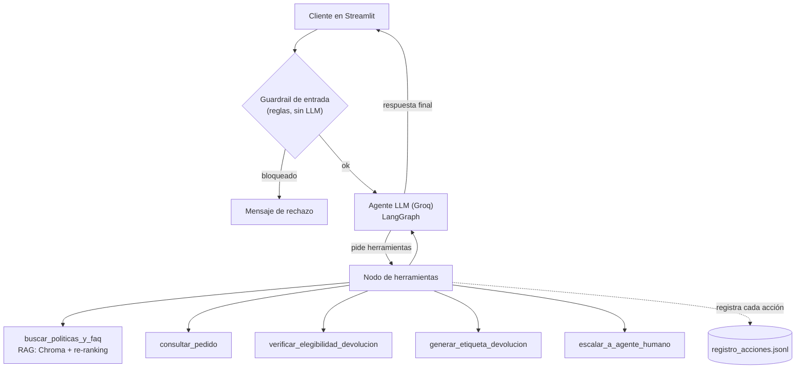

# Proyecto Final — EcoMarket: Agente de IA para devoluciones

Continuación del [Taller 2](https://github.com/Aguado4/taller2-GenAI-EcoMarket):
el asistente RAG de EcoMarket ahora es un **agente** que ejecuta solo el
proceso de devolución. Verifica la elegibilidad del pedido, genera la
etiqueta de devolución o escala el caso a un humano. Todo se usa desde
una interfaz web en Streamlit.

| Fase | Entregable |
|---|---|
| 1 — Diseño de la arquitectura del agente | [`respuestas/fase1_diseno_agente.md`](./respuestas/fase1_diseno_agente.md) |
| 2 — Implementación y conexión de componentes | código (`agent/`, `rag/`) + [`respuestas/fase2_implementacion.md`](./respuestas/fase2_implementacion.md) |
| 3 — Análisis crítico y propuestas de mejora | [`respuestas/fase3_analisis_critico.md`](./respuestas/fase3_analisis_critico.md) |
| 4 — Despliegue | `app_streamlit.py` + [`respuestas/fase4_despliegue.md`](./respuestas/fase4_despliegue.md) |
| Casos de prueba | [`respuestas/casos_de_prueba.md`](./respuestas/casos_de_prueba.md) |

## Arquitectura



El RAG del Taller 2 es **una herramienta más** del agente: el LLM decide
cuándo consultarla, igual que cualquier otra.

## Estructura

```
proyecto final genAI/
├── app_streamlit.py          # UI: chat + grafo del agente + monitoreo
├── agent/
│   ├── graph.py              # Grafo LangGraph (guardrail -> agente <-> herramientas)
│   ├── tools.py              # 5 herramientas LangChain (+ auditoría y manejo de errores)
│   ├── services.py           # Sistemas simulados: pedidos, reglas, etiquetas, tickets
│   ├── audit.py              # Registro de acciones (observabilidad)
│   ├── config.py             # Modelo, rutas, fecha simulada, límites
│   ├── prompts/v1.toml       # Prompt de sistema versionado
│   └── evaluate.py           # Batería de 13 casos de comportamiento
├── rag/
│   ├── ingest.py             # Construye el índice de Chroma (igual al Taller 2)
│   └── retriever.py          # Retrieval + re-ranking (CrossEncoder)
├── knowledge_base/           # Política de devoluciones, catálogo, FAQ
├── data/                     # pedidos.json (TRK-2001..2010) y productos.json
├── tests/                    # 32 tests de la lógica de negocio y del guardrail
├── outputs/evidencia_agente.md
└── respuestas/               # Fases 1-4 y casos de prueba
```

## Cómo ejecutarlo

```bash
python -m venv venv
venv\Scripts\activate                 # Windows
pip install -r requirements.txt
cp .env.example .env                  # pegar la GROQ_API_KEY (gratis en console.groq.com)
python -m rag.ingest                  # construir el índice vectorial (una vez)
streamlit run app_streamlit.py
```

## Cómo probarlo

- **En la app:** la barra lateral trae botones con los 8 escenarios
  principales (devolución aprobada, fuera de plazo, falta un dato, escala
  a humano, RAG, estado de pedido, pedido inexistente, prompt injection).
  Debajo de cada respuesta está la traza: qué herramientas usó, con qué
  argumentos y qué devolvieron. La pestaña **Grafo del agente** resalta
  los nodos por los que pasó el último turno.
- **Automático:** `python -m agent.evaluate` corre los 13 casos de
  [`respuestas/casos_de_prueba.md`](./respuestas/casos_de_prueba.md) y
  agrega los resultados a `outputs/evidencia_agente.md`.
- **Tests sin LLM:** `pytest` (reglas de elegibilidad, etiquetas sin
  duplicados, validaciones, guardrail).

Los pedidos son simulados y la fecha "de hoy" del sistema es fija
(2026-10-21), para que los resultados no cambien según el día de la prueba.
