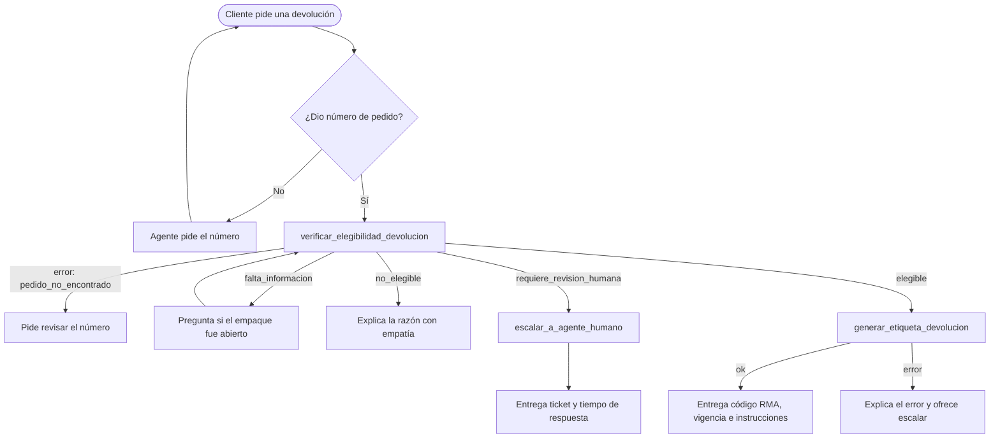

# Fase 1 — Diseño de la Arquitectura del Agente

## Extensión de la arquitectura RAG

El RAG del Taller 2 (Chroma + embeddings multilingües + re-ranking con
cross-encoder) se incorpora como **una herramienta más del agente**
(`buscar_politicas_y_faq`), no como una ruta separada de un router.

> **POR COMPLETAR (tu justificación):** ¿por qué herramienta y no router?
> Ideas para orientarte: con un router las reglas de entrada deciden antes
> del LLM (más predecible y barato, pero rígido ante mensajes mixtos como
> "¿cuánto cuesta la mochila y puedo devolver la de mi pedido TRK-2004?");
> como herramienta el LLM decide y puede combinar RAG + acciones en el
> mismo turno, a cambio de depender de su criterio.

## Definición de las herramientas

Cinco herramientas: cuatro de acción/consulta más el RAG. Todas devuelven
un JSON con `"ok": true/false`. Si falla, incluyen un código de `error` y
un `mensaje` legible para que el agente lo explique al cliente.

| Herramienta | Entrada | Salida (éxito) | Errores posibles |
|---|---|---|---|
| `buscar_politicas_y_faq` (RAG) | `consulta` | Top 3 fragmentos re-rankeados con fuente y score, y `hay_informacion_relevante` (umbral de re-ranking −3.0) | Sin información relevante → instrucción de no inventar |
| `consultar_pedido` | `numero_pedido` (acepta `TRK-2001`, `trk2001`, `2001`) | Cliente, producto, categoría, estado, fechas; email enmascarado y sin dirección | `pedido_no_encontrado` |
| `verificar_elegibilidad_devolucion` | `numero_pedido`, `empaque_abierto` (opcional), `producto_con_problema`, `motivo` | `resultado` ∈ {`elegible`, `no_elegible`, `requiere_revision_humana`, `falta_informacion`}, `razon`, `siguiente_paso`, días desde la entrega y fecha límite | `pedido_no_encontrado`, `producto_sin_politica` |
| `generar_etiqueta_devolucion` | `numero_pedido` | Código RMA, dirección de recolección, transportista, vigencia de 7 días, instrucciones. Si ya existía, devuelve la misma (`reenviada: true`) | `elegibilidad_no_verificada`, `pedido_no_elegible`, `pedido_no_encontrado` |
| `escalar_a_agente_humano` | `motivo`, `resumen`, `numero_pedido` (opcional), `prioridad` (`normal`/`alta`) | `ticket_id`, tiempo estimado de respuesta (24 h, o 4 h si es prioridad alta) | `datos_incompletos`, `pedido_no_encontrado` |

Reglas que aplica `verificar_elegibilidad_devolucion` (tomadas de la
política de devoluciones de la base de conocimiento):

- Pedido cancelado o no entregado → `no_elegible`.
- Alimentos/perecederos → `no_elegible`; si llegó dañado o vencido → `requiere_revision_humana`.
- Higiene "no devolvible" (cepillo de dientes) → `no_elegible`; con defecto → `requiere_revision_humana`.
- Higiene "no devolvible si abierto": sin dato → `falta_informacion`;
  abierto → `no_elegible`, o `requiere_revision_humana` si tiene defecto; sin abrir → sigue a la regla de plazo.
- Plazo de 30 días desde la entrega: fuera de plazo → `no_elegible`,
  o `requiere_revision_humana` si hay un problema con el producto.

**Salvaguarda de diseño:** `generar_etiqueta_devolucion` se niega si no
existe una verificación `elegible` previa para ese pedido. La regla está
en el código, no solo en el prompt, así que el LLM no puede saltársela.

## Selección del marco de agentes

**LangChain + LangGraph.**

> **POR COMPLETAR (tu justificación):** tus razones fueron que es el marco
> que más conoces y que LangGraph permite ver el diagrama de flujo y el grafo
> de decisiones del agente. Puedes complementarlas comparando con
> LlamaIndex (más orientado a indexación y recuperación de documentos;
> sus agentes existen, pero el control explícito del flujo es menor).

Hechos del proyecto que apoyan la elección:
- El Taller 2 ya usaba LangChain (Chroma, embeddings, splitters), así que
  la integración del RAG como herramienta fue directa.
- `@tool` convierte una función de Python con docstring y type hints en
  una herramienta con esquema JSON para el LLM.
- LangGraph permite agregar nodos propios (el guardrail de entrada),
  memoria por conversación (`InMemorySaver`), un límite de pasos y
  `draw_mermaid()`, que la app usa para dibujar el grafo en vivo.

## Flujo del proceso de devolución

