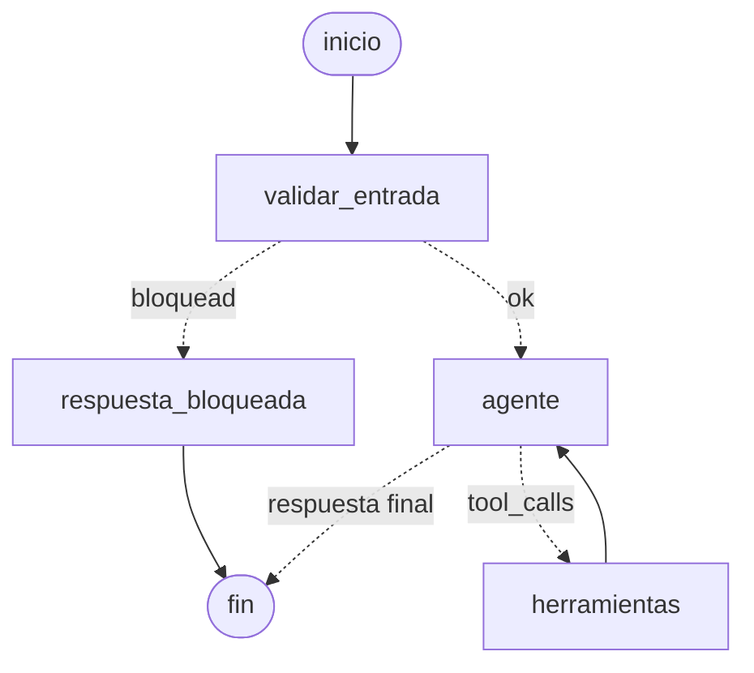

# Fase 2 — Implementación y Conexión de Componentes

## Extensión del código base

| Del Taller 2 | En el proyecto final |
|---|---|
| `rag/ingest.py` (chunking + embeddings + Chroma) | Igual. La política de devoluciones ahora cuenta el plazo desde la entrega y explica la etiqueta y el código RMA |
| `rag/pipeline.py` (retrieval → re-ranking → generación) | `rag/retriever.py`: solo retrieval + re-ranking. La generación la hace el agente con lo que devuelve la herramienta |
| Prompts versionados `vN.toml` | `agent/prompts/v1.toml` (prompt de sistema del agente) |
| Groq como LLM | Groq vía `langchain-groq` (`ChatGroq`), con tool calling |

Capas nuevas:

1. **`agent/services.py`:** los "sistemas externos" simulados (pedidos,
   motor de reglas, generador de etiquetas, mesa de ayuda). Es lógica
   determinista, sin LLM, y está cubierta por tests.
2. **`agent/tools.py`:** las herramientas de LangChain que envuelven esos
   servicios. Registran cada llamada y convierten cualquier excepción en
   un error controlado.
3. **`agent/graph.py`:** el grafo de LangGraph y la función `run_turn`,
   que devuelve la respuesta junto con la traza (ruta y herramientas).

## Arquitectura del agente (grafo)

- **`validar_entrada`:** guardrail por reglas, sin LLM. Bloquea mensajes
  vacíos, de más de 1500 caracteres o con patrones de prompt injection
  ("ignora las instrucciones", "system prompt", "modo desarrollador"...).
  El mensaje bloqueado nunca llega al LLM.
- **`agente`:** el LLM con las 5 herramientas enlazadas (`bind_tools`).
  Decide si responde directo o pide una o varias herramientas.
- **`herramientas`:** `ToolNode` ejecuta lo pedido y vuelve al agente.
  Es el bucle ReAct: razona, actúa, observa.
- **Memoria:** `InMemorySaver` con un `thread_id` por conversación. Así
  el caso "falta información" funciona en dos turnos.
- **Límite de pasos:** `recursion_limit = 12`. Si el agente entra en un
  bucle, se corta y se responde con un mensaje seguro.

## Manejo de respuestas (éxito y error)

| Situación | Dónde se maneja | Qué ve el cliente |
|---|---|---|
| Elegible | Agente → `generar_etiqueta_devolucion` | Código RMA, vigencia, instrucciones y tarjeta de etiqueta descargable |
| No elegible | `verificar_elegibilidad` devuelve `razon` | Explicación empática de la regla aplicada |
| Excepción | `requiere_revision_humana` → `escalar_a_agente_humano` | Número de ticket y tiempo de respuesta |
| Falta un dato | `falta_informacion` | Una pregunta concreta (si el empaque fue abierto) |
| Pedido inexistente | `pedido_no_encontrado` | Pide revisar el número, sin escalar |
| Etiqueta sin verificar o no elegible | Bloqueada en `services.generar_etiqueta` | El agente no puede saltarse la regla |
| Etiqueta duplicada | Idempotencia por pedido | Reenvía la misma etiqueta |
| Excepción inesperada en una herramienta | `tools._run` → `error_interno` | Mensaje simple y oferta de escalar |
| Error del LLM (red, cuota) o bucle | `run_turn` | Mensaje de disculpa; la UI abre un hilo nuevo |
| Argumentos inválidos del LLM | `ToolNode` devuelve el error al agente | El agente reintenta con argumentos corregidos |

## Evaluación del comportamiento

`python -m agent.evaluate` corre 13 casos, cada uno en una conversación
nueva. Por caso, define qué herramientas **deben** usarse y cuáles **no**.
Así se evalúa si el agente sabe cuándo usar herramientas y cuándo
responder directo. Resultado: **13/13** (detalle en
[`casos_de_prueba.md`](./casos_de_prueba.md) y en
`outputs/evidencia_agente.md`).

Ajuste durante el desarrollo: en la primera corrida, 2 casos fallaron
porque el modelo preguntaba si el empaque estaba abierto **antes** de
verificar, aunque para productos de hogar ese dato no importa. Se agregó
al prompt un ejemplo explícito de "verificar primero; la herramienta dice
si falta algo". Después, 12 de 12 corridas repetidas fueron correctas.
Como lección, el que decide qué datos importan debe ser el motor de
reglas, no el LLM.
